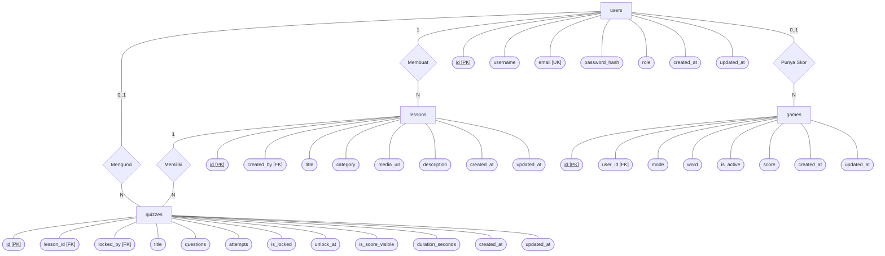
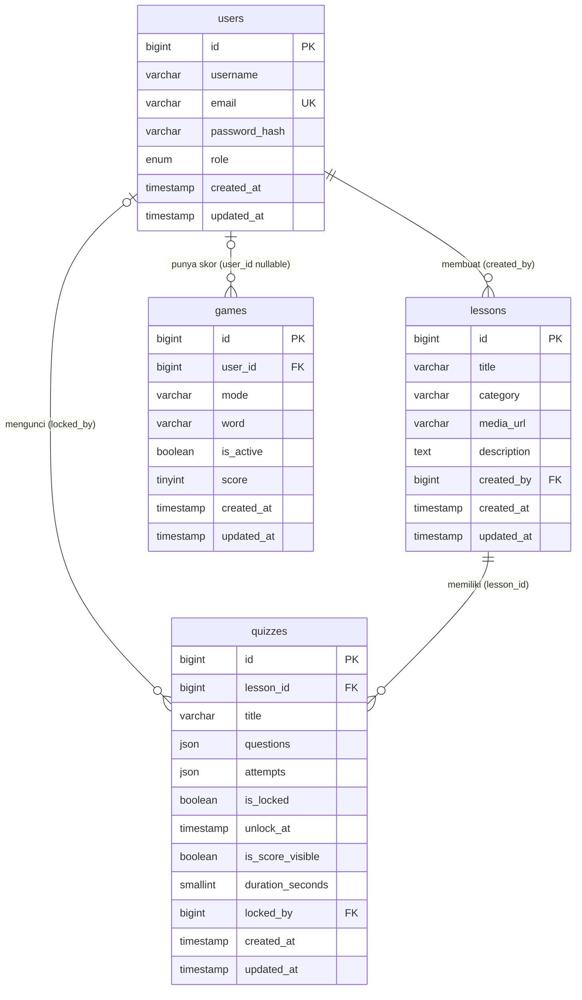

# TeachSign

**TeachSign** adalah *Learning Management System* (LMS) berbasis Laravel untuk pembelajaran bahasa isyarat secara interaktif melalui materi visual, kuis pilihan ganda/esai, dan mini-game. Aplikasi dibangun dengan struktur data yang ringkas: 4 tabel inti, soal serta percobaan kuis disimpan sebagai JSON.

## Anggota Kelompok

| No. | Nama                     | NPM            |
|:---:|:-------------------------|:--------------:|
| 1   | Dandy Erlangga Aryaputra | `140810210032` |
| 2   | Raffi Fauzan             | `140810250067` |

## Tujuan & Target SDGs

- **SDG 4 (Quality Education)** — edukasi bahasa isyarat yang interaktif, inklusif, dan mudah diakses.
- **SDG 10 (Reduced Inequalities)** — meningkatkan kesadaran masyarakat terhadap bahasa isyarat dan kesetaraan komunikasi.

## Fitur

### Admin
- Kelola akun pengguna (tambah, ubah, hapus).
- Kelola materi, kuis, bank kata Word Quest.
- Buka/kunci kuis dan atur visibilitas nilai.
- Nilai jawaban esai manual.
- Pantau progres siswa dan attempt kuis.

### Siswa
- Lihat materi visual.
- Kerjakan kuis pilihan ganda/esai.
- Mainkan mini-game: Sign Rush, Word Quest, Flip Flap.
- Lihat progres dan skor terbaik.

> Registrasi publik tersedia di `/register` dan otomatis menambahkan akun siswa; admin juga dapat menambah, mengubah, dan menghapus akun melalui menu Users.

## Teknologi

- PHP 8.3+, Laravel 13
- MySQL 8 atau SQLite lokal
- Laravel Sanctum bearer token
- Blade + CSS statis `public/css/app.css`
- PHPUnit + SQLite `:memory:`
- Laravel Pint

## Instalasi

```bash
cd teachsign
composer install
copy .env.example .env
php artisan key:generate
```

Atur DB di `.env`, lalu:

```bash
php artisan migrate --seed
php artisan serve
```

## Akun Demo

| Peran  | Email                  | Password      |
|:-------|:-----------------------|:--------------|
| Admin  | `admin@teachsign.test`  | Password123   |
| Siswa  | `siti@teachsign.test`   | Password123   |
| Siswa  | `budi@teachsign.test`   | Password123   |
| Siswa  | `dewi@teachsign.test`   | Password123   |

## Halaman Web Utama

- Materi: `/learn/lessons`
- Kuis: `/learn/quizzes`
- Mini-game: `/learn/games`, mode `sign`, `word`, `flip`
- Progres: `/learn/progress`
- Admin: `/admin/users`, `/admin/lessons`, `/admin/quizzes`, `/admin/grading`, `/admin/progress`, `/admin/word-quest`

## REST API

Base URL: `http://127.0.0.1:8000/api`. Gunakan bearer token Sanctum.

### Auth

| Method | Endpoint   | Body               | Keterangan |
|:-------|:-----------|:-------------------|:-----------|
| POST   | `/login`   | `email`, `password` | Token + user |
| GET    | `/me`      | -                  | User aktif |
| POST   | `/logout`  | -                  | Token dicabut |

Tamu menerima `401`; siswa ke endpoint admin menerima `403`.

### Student / Terotentikasi

| Method | Endpoint        | Query/Body                                              | Keterangan |
|:-------|:----------------|:--------------------------------------------------------|:-----------|
| GET    | `/lessons`      | -                                                       | Daftar materi (paginated) |
| GET    | `/lessons/{id}` | -                                                       | Detail materi + kuis |
| GET    | `/quizzes`      | -                                                       | Daftar kuis |
| GET    | `/quizzes/{id}` | -                                                       | Detail kuis, tanpa jawaban benar bila siswa |
| POST   | `/quizzes/{id}` | `answers` object keyed by id soal                       | Submit kuis |
| GET    | `/games`        | -                                                       | Daftar mode |
| GET    | `/games/{mode}` | -                                                       | Detail mode |
| POST   | `/games/{mode}` | `hits`, `misses`, `max_combo`, `seconds`               | Simpan skor terbaik |
| GET    | `/progress`     | -                                                       | Ringkasan progres |

Contoh response submit kuis:

```json
{
  "score": 100,
  "correct": true,
  "visible": true,
  "correct_answers": {"0": "Tiga"}
}
```

`correct_answers` hanya ada jika `is_score_visible` aktif.

### Admin

| Method | Endpoint                                 | Semantik |
|:-------|:-----------------------------------------|:---------|
| *      | `/admin/users`                           | CRUD user |
| *      | `/admin/lessons[/{id}]`                  | CRUD materi |
| *      | `/admin/quizzes[/{id}]`                  | CRUD kuis |
| PATCH  | `/admin/quizzes/{id}/toggle-lock`        | Buka/kunci kuis |
| *      | `/admin/words[/{id}]`                    | Kelola bank kata Word Quest (tanpa show) |
| GET    | `/admin/grading`                         | Daftar attempt esai |
| PATCH  | `/admin/grading/{quiz}/{attempt}`        | Simpan nilai esai |
| GET    | `/admin/progress`                        | Progres seluruh siswa |

`*` = `GET`, `POST`, `PUT/PATCH`, `DELETE` sesuai konvensi resource.

## Skema Database

Tabel inti: `users`, `lessons`, `quizzes`, `games`. Soal, attempt, dan skor kuis disimpan sebagai JSON.

- `users`: `username`, `email` (unique), `password_hash`, `role` (`admin`/`student`)
- `lessons`: `title`, `category`, `media_url`, `description`, `created_by`
- `quizzes`: `lesson_id`, `title`, `questions`, `attempts`, `is_locked`, `unlock_at`, `is_score_visible`, `duration_seconds`, `locked_by`
- `games`: bank kata dan skor mini-game dalam satu tabel; `user_id` null untuk bank kata, `word` null untuk skor, `mode` nullable, `score` nullable 0-100.

Question JSON:

```json
{
  "question": "Gerakan tangan untuk sapaan halo adalah?",
  "type": "choice",
  "options": ["Melambaikan tangan", "Menggenggam tangan"],
  "correct_answer": "Melambaikan tangan"
}
```

Attempt JSON:

```json
{
  "user_id": 2,
  "answers": {"0": "Melambaikan tangan"},
  "choice_correct": 1,
  "choice_total": 1,
  "essay_total": 0,
  "score": null,
  "status": "pending",
  "graded_by": null,
  "graded_at": null,
  "created_at": "2026-11-04T08:00:00+00:00"
}
```

## Pengujian

```bash
php artisan test
```

Status terakhir: 68 test lulus, 286 assertion. Enam belas test Feature/Api mencakup auth, materi, kuis, game, progres, dan admin.

Pemeriksaan kode:

```bash
./vendor/bin/pint
```

## Catatan Teknis

- JSON menyimpan soal dan attempt agar skema tetap ringkas; attempt tidak bisa difilter SQL.
- `Quiz::addAttempt` memakai pola baca-ubah-tulis (tag `shortcut:`).
- Skor mini-game disimpan hanya jika lebih tinggi.
- Login API dibatasi 6 percobaan/menit/IP.

## Troubleshooting

- Cek koneksi database dan konfigurasi `.env` bila migrasi gagal.
- Gunakan `php artisan migrate:fresh --seed` bila boleh menimpa data.
- Pastikan internet tersedia untuk CDN.

# Flow Chart



## ERD



Relasi:

- `lessons.created_by` → `users.id` (`RESTRICT`)
- `quizzes.lesson_id` → `lessons.id` (`CASCADE`)
- `quizzes.locked_by` → `users.id` (`SET NULL`)
- `games.user_id` → `users.id` (`CASCADE`) untuk baris skor
- `games` memuat bank kata saat `user_id`, `mode`, dan `score` bernilai `null`
- `quizzes.attempts` menyimpan `user_id` tetapi bukan relasi FK karena attempt disimpan sebagai JSON
- `quizzes.questions` memakai indeks array, dan indeks tersebut menjadi id soal jawaban siswa
